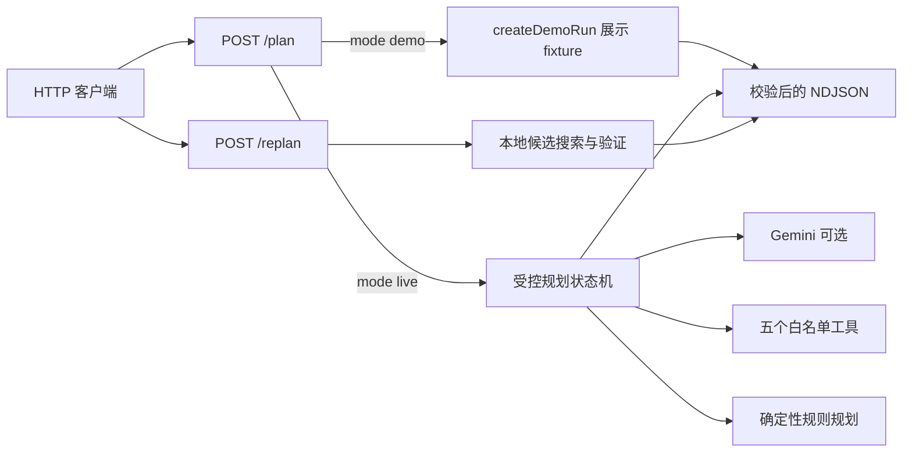
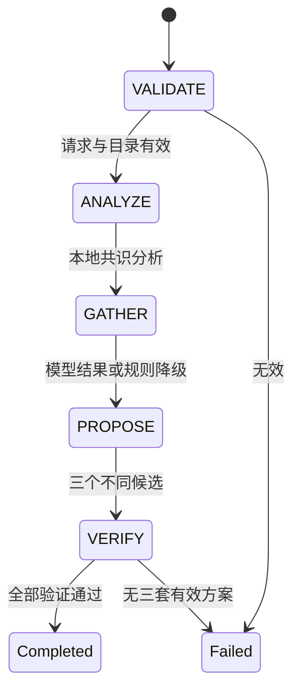

# Agent 架构

## 请求与事件

浏览器当前直接读取 `createDemoRun()`，未调用图中的 HTTP 端点。两个端点的请求由 `src/contracts/agent.ts` 中的 Zod Schema 校验。成功响应为 `application/x-ndjson`，每行一个事件，最后恰好一个 `run.completed` 或 `run.failed`；不合法请求返回 JSON 错误对象。

## 初始规划

初始实时规划最多发起 **2 次模型请求**，最多执行 **6 次模型请求的工具调用**，且只接受 `get_weather`、`search_places`、`estimate_route`、`calculate_budget`、`validate_plan`。工具名与参数在服务端校验；第二次模型响应不能再触发工具执行。代码负责请求校验、地点目录、偏好共识、工具调用、候选数据规范化、路线与预算重算、硬约束验证，以及向客户端发出事件。模型只提议工具调用和候选行程，不能决定最终是否通过验证。每个候选的确定性验证独立于六次模型请求工具调用，事件中按工具汇总为三条 `verification: true` 记录。

缺少 `GEMINI_API_KEY` 或 `GEMINI_MODEL`、模型出错、无效调用、工具失败或候选验证失败时，运行会发出 `run.degraded` 并尝试规则规划。规则方案也必须通过同一验证；若无法形成三套有效行程，终止于 `run.failed`。未调用天气工具就没有天气证据。天气工具的查询范围由服务端从请求日期和时间生成，坐标固定在上海人民广场附近；Open-Meteo 失败返回 `WEATHER_UNAVAILABLE`，不会生成虚构天气。

初始成功结果的 `candidateIds` 恰好三个，且没有 `diff`。`mode: "demo"` 是固定展示事件，不执行实时规划。其部分 `placeId` 不在服务端地点目录中，不能作为重排输入。

## 局部重排

`POST /.netlify/functions/replan` 不调用 Gemini 或网络。请求包含完整原方案、两人的偏好、设定、`rejectedStopId`、`lockedStopIds`、原因和 `replanCount`（只允许 0 或 1，因此最多两轮）。服务端从静态目录选择未出现在原方案中的替代地点，只调整被否决站点及必要时相邻、未锁定站点的时间；其余站点保持原样。锁定站点不能被否决，否则返回 `409 LOCKED_STOP_CONFLICT`。找不到满足时间、路线、预算和其他硬约束的替代方案时返回 `422 NO_VALID_REPLAN`。

成功重排依次发出 `REPLAN`、本地路线/预算/验证工具摘要、`VERIFY`、一个 `plan.proposed`，然后以只含一个元素的 `candidateIds` 和必需的 `diff` 结束。`diff` 列出替换站点 ID 与保留站点 ID。

## 数据可信度

`data/places.shanghai.json` 是静态地点目录，包含来源网址、营业时间、价格区间和 `lastVerifiedAt`。验证器对距计划日期超过 90 天的来源数据生成 `STALE_PLACE_DATA` 警告，但这些字段并非实时核实。路线使用坐标直线距离及固定步行/交通速度估算，预算使用目录价格上限、每段交通补贴和缓冲率计算；都不代表实时路况、班次、票价或营业状态。展示 fixture 中的天气与数值也仅用于演示。
